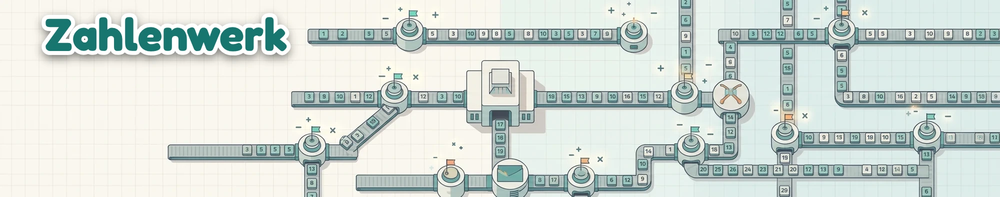

# Zahlenwerk – the number factory



A cozy browser game about conveyor belts. Numbered tiles leave the factory, ride through stations, adders and gates, and have to reach the mailbox that wants them. You never do the maths yourself: every mailbox shows what the waiting tile would become on the way there. The challenge is timing, juggling several tiles at once, and using each level's machines well.

**Play:** open `index.html` in a browser. There's no build step and nothing to install.

## Levels

| # | Level | What's new |
|---|---|---|
| 1 | First Shift | Sending tiles and pointing a switch |
| 2 | Recycling | Junk tiles, a 3-way switch, the recycler |
| 3 | Distribution | Four mailboxes; one key sets every switch on the way |
| 4 | The Adder | A machine that holds one tile and merges it with the next into their sum |
| 5 | Holding Track | Gates you click to stop and release tiles |
| 6 | Special Delivery | Golden tiles (double points), wildcards (fit any order), bombs (recycle them!) |
| 7 | Half & Swap | ½ (odd numbers break), ⇄ digit swap (12 → 21) |
| 8 | Grand Factory | Everything at once |

Each level has a goal (fill N orders, and on adder levels a number of sums). Stars: ★ for finishing, ★ for losing no gear, ★ for beating the par time. Progress is saved in the browser.

## Controls

| Key | Action |
|---|---|
| <kbd>Space</kbd> / click the factory | Send the waiting tile |
| <kbd>1</kbd>–<kbd>4</kbd> / click a mailbox | Set every switch on the route to that mailbox |
| <kbd>0</kbd> / <kbd>X</kbd> / click the recycler | Route to the recycler |
| <kbd>A</kbd> / click the adder | Route to the adder |
| Click a switch | Flip just that switch (right-click flips backwards) |
| Click a gate / <kbd>G</kbd> | Close or open one gate / all gates |
| <kbd>P</kbd> / <kbd>Esc</kbd> | Pause |

## Reading the board

- **Chips under each mailbox** show what the waiting tile would arrive as: `→ 14 ✓` fills an order, `(taken)` means another tile is already on its way to that order, `+ ?` means it would wait in the adder.
- **Badges on moving tiles** show what each one will do with the current switch settings: ✓ fill an order, ✕ wrong, ♻ recycler, + wait in the adder, 2 another tile gets there first, ! bomb in the wrong place. The prediction plays all tiles forward in arrival order, adder merges included.
- A switch only matters at the moment a tile reaches it, so you can send the next tile right away and change the route once the previous tile has passed.
- Up to 6 tiles fit in the factory queue. If it overflows, the factory jams and sends tiles out wherever the switches point.

Fairness: every order is generated together with the tiles that can fill it, including both halves of an adder sum. When a tile is waiting in the adder, the factory plans a matching partner next. If no order can use the held tile, the adder's order changes to one that can.

## Project layout

```
index.html                 the whole game (canvas + vanilla JS, no dependencies)
assets/*.png               machine and tile sprites rendered in Blender
blender/render_sprites.py  script that models and renders the sprites
zahlenwerk-wallpaper.webp  the original artwork the game is based on
```

If a sprite can't be loaded, the game falls back to drawing that machine with canvas shapes.

## Re-rendering the sprites

```sh
/Applications/Blender.app/Contents/MacOS/Blender -b -P blender/render_sprites.py -- "$PWD/assets"
```

The sprites are rendered with Cycles in an orthographic view tilted 37° (so the cylinders match the 0.8 ellipse ratio used in the game). A shadow-catcher plane provides soft drop shadows, and an ink outline is added afterwards around each silhouette. Scale: 1 Blender unit = 50 game px, rendered at 2×.
